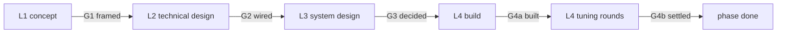
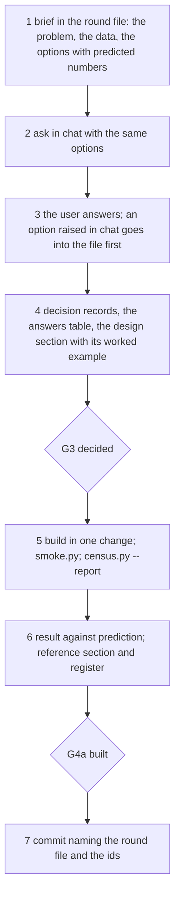

# How we work

The method for designing, building and tuning Strain: four levels
with a gate each, a round protocol that puts the brief in a file
before anything is asked, a decision log, data files, a register per
system, and the format every document follows. Terms are in
`glossary.md`. This is the only place procedure is described;
`plan.md` and `CLAUDE.md` point here.

## At a glance

- Four levels: L1 concept, L2 technical design, L3 vertical system design, L4 implementation and tuning; gates G1 framed, G2 wired, G3 decided, G4a built, G4b settled.
- A round is file first: the brief with options and predicted numbers is written to `docs/data/round-*.md` before any question is asked in chat.
- Every answer becomes a decision record in `docs/decisions.md`, grouped by system; docs cite ids, never retell.
- Every census and every round's result is a file under `docs/data/` with a standard header; docs link and quote the few lines that matter.
- Design (as decided) lives in `design.md`; what the code does (as built) in `nations.md`, with a register of variables, formulas and dependencies per system.
- Every doc starts with At a glance and Summary; numbers live in tables and worked examples, not prose; formulas carry ids; diagrams are Mermaid blocks, the dependency graph generated from the code.
- `tools/doclint.py` checks the format, the ids, the registers against the code and the data headers; `tools/smoke.py` keeps every commit green.

## Summary

Design work is sorted into four levels so a question is asked at the
level it belongs to and a level is closed by a checklist, not a
feeling. Within a level, work runs in rounds: the agent writes a brief
with the problem, the data and the options as numbers, asks in chat
with the same options, records the answers as decision records, builds
in one change with its probe, and closes the round with a report that
sets prediction against the census. Documents follow one format so the
reader finds the point at the top and the detail by system below.
Scripts check what can be checked.

## 1. Levels and gates

| Level | Name | Answers | Lives in | Gate |
|---|---|---|---|---|
| L1 | High-level conceptual design | what the thing is for, the loop, principles, scope, units | `design.md` §1–3, §6–7 (later `docs/concept.md`) | G1 framed |
| L2 | High-level technical design | parts, slot order, interfaces, naming, budgets (levers, ms a day) | `design.md` §8–10, `nations.md` §0 (later `docs/architecture.md`) | G2 wired |
| L3 | Vertical system design | one system: questions, mechanism, formulas, a worked example on paper | `design.md` §5.x (as decided) and its round files | G3 decided |
| L4 | Implementation and tuning | build, probe, census, tune, record | the code, `nations.md` §n (as built, register), round and census files | G4a built, G4b settled |

A question belongs to the lowest level whose answer it changes. "Does
a war annex territory" is L3 (the war system); "do wars exist" is L1;
"in which slot does war run" is L2; "is attrition 0.3% or 0.5%" is L4.



**G1 framed** holds when:

- the loop is at most five numbered items;
- every principle names the failure it guards against and how a breach shows;
- scope is a table of in, out and later;
- units are a table;
- every choice has a decision record.

**G2 wired** holds when:

- every interface between modules is a table: the slot order, the pillar hooks, the naming rules for ledger keys, fields, readouts and census keys;
- each interface has a smoke flag;
- the budgets are stated: levers per system, milliseconds a day, smoke seconds;
- every choice has a decision record.

**G3 decided** holds when:

- the round files of the system are closed: every question has a decision record;
- the design section has a mechanism whose steps name their formula ids, and a worked example that balances;
- the levers are listed with their proposed defaults and why;
- doclint passes.

**G4a built** holds when:

- the smoke test is green with the system's own flags;
- a census report is committed and linked from the reference section;
- the reference section is complete, including the register, and doclint confirms every lever and constant in the code appears in it;
- the levers are within the target or over it by a decision record;
- every departure from the design has a decision record;
- the system has card rows, a layer where one makes sense, and wire headlines for its transitions;
- the phase's row in `plan.md` is updated.

**G4b settled** holds when, for a tuning round:

- the after-census is committed;
- the verdict is written: keep, revert or follow-up;
- the defaults in the code equal the lever table;
- the lever table's "moved in" column cites the round.

## 2. The round protocol (L3 and L4)

A round is one file, `docs/data/round-<date>-<system>-<n>.md`, from
`docs/templates/round.md`, that lives through the whole cycle.

| Step | Who | What | Where |
|---|---|---|---|
| 1 | agent | Writes the brief: the problem in at most eight lines; the census lines that show it; every question with its options, each with a mechanism in one line, a predicted effect as a number, a cost, one marked recommended. Nothing is asked that is not in the file. | round §1–2 |
| 2 | agent | Asks in chat with the multi-choice tool: at most five questions a round, at most four options each, labelled as in the file; each option's text carries its mechanism and predicted number, so the user can answer from chat or from the file. | chat |
| 3 | user | Answers. An option raised in chat is added to the file before it is chosen. | round §2–3 |
| 4 | agent | One decision record per answer; the answers table; the design section written or updated with the mechanism, formula ids and the worked example on paper. **G3.** | `decisions.md`, round §3, `design.md` §5.x |
| 5 | agent | Builds in one change: code, smoke flag, census line, card rows, layer, wire. Runs `python tools/smoke.py`, then `python tools/census.py --report <system>-<n>`. | code, `docs/data/census-*.md` |
| 6 | agent | Fills the result: predicted against actual, the build notes, the round's At a glance and Summary; the reference section and its register; departures and over-target levers get decision records. **G4a.** | round §4–5, `nations.md` §n |
| 7 | agent | Commits; the message names the round file and the decision ids. | git |



A tuning round (L4) is the same file: §1 is a hypothesis (which census
lines should move, which way, by how much), §2 the lever moves with
predicted effects, the user picks one, a census runs before (or the
last report stands) and after, §5 carries the verdict. A decision
record is written only when a default changes in the code or a
constant becomes a lever.

Rounds in chat follow three rules: the file is written first; the
chat repeats the options, never adds to them without updating the
file; the answer is recorded before anything is built.

## 3. Decision records

One record per decision, at most eight lines, from
`docs/templates/decision.md`, appended to the system's section of
`docs/decisions.md`:

```
### WAR-04 · 2026-10-09 · Conscripts: half a percent of the people serve whatever the budget
- Level L3 · Status decided
- Context: design.md §5.5 round 3; data/round-2026-10-09-war-3.md Q1
- Options: A conscripts 0.5% (chosen) · B the army is what the wages pay (the broke have no army)
- Decision: every nation keeps 0.5% of its people under arms, unpaid, whatever its budget.
- Effect: war.js armyMin 0.005; nations.md §6
```

| Rule | Detail |
|---|---|
| id | `<PREFIX>-<nn>`: CON concept, ARC architecture, FND foundations, ECO economy, PRD products, TRD trade, HLT health, REL relations, WAR war, REG regimes, OUT outbreak, PLY player pressure, PRC process |
| numbering | Ascending within a prefix, never reused; a superseded record keeps its number and its status changes to `superseded by <id>` or `reverted` |
| layout | `decisions.md` has one `##` section per prefix in level order; records chronological within a section; the At a glance table counts records per system |
| citing | Docs cite the id; the record carries the reasons; a doc never retells a decision in prose |
| what counts | Any answer in a round; any departure from a design; any lever over target; any default changed in a tuning round; any constant promoted to a lever; any gap accepted at a gate |

## 4. Data files

Everything measured lives under `docs/data/` and is listed in
`docs/data/index.md` (date, kind, system, commit, one-line result).

| Kind | File | Written by | Holds |
|---|---|---|---|
| census report | `census-<date>-<slug>.md` | `python tools/census.py --report <slug>` | header (date, commit, command, seeds, days, pillars, ms a day), At a glance and Summary filled in by the agent after reading, world lines (min, median, max), nations flagged in at least half the seeds, per-seed top tables |
| round | `round-<date>-<system>-<n>.md` | the agent, through the round | header (level, system, round, commits, census links, decisions, status), brief, options, answers, build notes, result with a verdict |
| raw | `raw/<slug>/seed-<n>.json` | `tools/census.py --out` | per-seed JSON; gitignored |

A report's At a glance says what the numbers mean; its Summary says
what changed since the last one. A result table sets the lines
predicted in the brief against what the census shows, before and
after, so a wrong prediction is visible and the lever that fixed or
broke something is named.

## 5. The register

Each system's reference section (`nations.md` §n, from
`docs/templates/system-reference.md`) carries three tables that answer
"how do the variables, formulas and systems relate":

| Table | Columns | Source |
|---|---|---|
| 3.1 Variables | code name, doc name, unit, kind (lever, K, field, world field, readout, ledger key, census key), where set (file:function), where read | `LEVERS`, `K`, `FIELDS`, `WORLD_FIELDS`, the `_` readouts, the `L.add` keys, the census keys |
| 3.2 Formulas | id, formula, symbols, levers in it, code (file:function) | the design section's mechanism, kept in step with the code |
| 2 Dependencies | reads or writes, other system, item, when (slot) | every `window.<PILLAR>` reference and every readout crossing a module |

`python tools/doclint.py` checks that every key of a pillar's `LEVERS`
and `K` appears in its register or lever tables; `--readouts` prints
the readouts each pillar sets and reads, to seed the dependency table.
Formula ids are per system (`trade F3`) and are cited in prose, in
rounds and in code comments.

## 6. Writing rules

Every document under `docs/` (the templates, `data/raw/` and the
legacy references `bench.md`, `map.md`, `player.md`, `nations.md`
excepted until converted) has this shape:

| Part | Rule |
|---|---|
| title | `# Title`, then an optional header table (owner, status, links) |
| At a glance | `## At a glance`: 5 to 10 bullets of one line each; numbers allowed; the reader who stops here knows what matters |
| Summary | `## Summary`: one paragraph, at most 120 words, saying what the document covers and what changed last |
| body | numbered `## N.` sections, item by item or system by system |
| numbers | in tables, formulas or worked examples; prose carries dates and decision ids only |
| paragraphs | at most six lines; a list of more than three parallel items is a table |
| formulas | carry an id; symbols are the register's doc names; units stated |
| terms | from `glossary.md`; a new term is added there in the same change |
| diagrams | Mermaid fenced blocks only (GitHub and VS Code's Mermaid preview render them, nothing to install); a flowchart for an order of steps, a state diagram for types and transitions, a sequence diagram for an exchange; the diagram shows the shape and a table beside it holds the numbers; the pillar dependency graph is generated by `python tools/doclint.py --mermaid` and pasted into `design.md` §10, never drawn by hand; a broken block shows on the pushed page, so look |
| length | concept 120 lines, architecture 150, a design section 200, a reference section 250, a round 80; tables and diagrams do not count |

The worked-example mini-format, used in design sections, rounds and
chat:

```
**Example: France, day 1, seed 11** (or "on paper")
| step | input | formula | result |
| labour | P 68, I 11.6 | F2 slots = infraSlots × I | 34.8 M |
reads: one line saying what the numbers mean
```

## 7. Checks

| Check | Command | When |
|---|---|---|
| format, ids, registers, data headers, line endings | `python tools/doclint.py` | before every commit that touches docs or a pillar |
| the page boots and every flag holds | `python tools/smoke.py` | before every commit |
| the world over six seeds and three years | `python tools/census.py --report <slug>` | at G4a and at every tuning round |
| a snippet in the booted page | `python tools/smoke.py --eval "return WORLD.day"` | while probing |

## 8. Commits

One change per round step that produces something: the brief and the
answers may share a commit with the design section; the build is one
commit with its smoke flags, census report and reference section. The
message names the round file and the decision ids. Every commit is
green on the smoke test. Files are LF.
